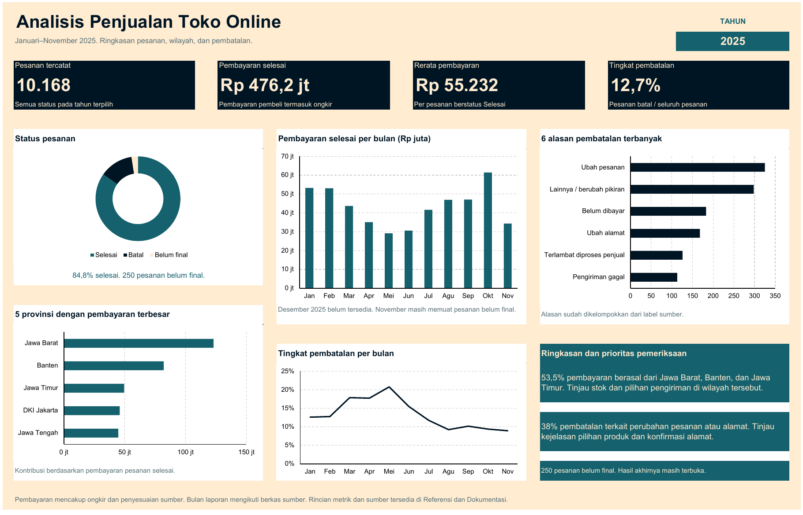
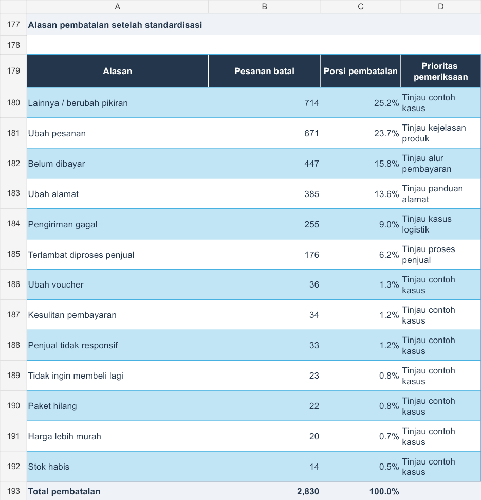

# Analisis Penjualan Toko Online dengan Excel

**20.848 pesanan · Desember 2023–November 2025 · Penjualan, wilayah, dan pembatalan**

Sebanyak **37,31% pembatalan** dalam dataset tercatat karena perubahan pesanan atau alamat. Sementara itu, tiga provinsi menyumbang lebih dari separuh pembayaran pesanan selesai. Dua temuan ini menjadi dasar untuk menilai bagian operasional toko yang layak diperiksa lebih dulu.

Proyek ini mengolah data pesanan marketplace Indonesia menjadi analisis Excel yang menelusuri pertumbuhan pembayaran, konsentrasi wilayah, serta pola pembatalan. Setiap ringkasan dilengkapi definisi metrik dan dapat ditelusuri ke data per pesanan.

Dashboard Excel menyajikan empat metrik utama dan lima grafik yang mengikuti pilihan tahun. Tampilan tiga kolom memadukan ringkasan status, tren bulanan, kontribusi wilayah, dan alasan pembatalan.

**[Unduh workbook Excel](https://github.com/Nnaely/analisis-penjualan-toko-online/raw/refs/heads/main/Portofolio_Penjualan_Ecommerce_Indonesia.xlsx)** · [Temuan lengkap](docs/TEMUAN_DAN_REKOMENDASI.md) · [Metodologi](docs/METODOLOGI.md)

## Dashboard

Pilih **2023, 2024, atau 2025** pada dropdown tahun di sheet Dashboard; pilihan awal adalah **2025**. Metrik, peringkat provinsi dan alasan pembatalan, serta narasi mengikuti tahun terpilih. Cakupan 2023 hanya Desember, sedangkan 2025 hanya Januari–November. Detail penggunaan tersedia pada [catatan dashboard](docs/CATATAN_DASHBOARD.md).

## Ringkasan seluruh data

| Metrik | Hasil |
| --- | ---: |
| Pesanan tercatat | 20.848 |
| Pesanan selesai | 17.768 |
| Pembayaran pesanan selesai | Rp1.045.550.734 |
| Rata-rata pembayaran per pesanan selesai | Rp58.845 |
| Pesanan batal | 2.830 atau 13,57% |
| Pesanan belum final | 250 |

Pembayaran pesanan selesai adalah nilai `Total Pembayaran` pada status Selesai, termasuk ongkir dan penyesuaian sumber. Nilai ini tidak digunakan sebagai ukuran pendapatan bersih atau laba.

## Temuan dan tindak lanjut

### 1. Perubahan pesanan dan alamat mencakup 1.056 pembatalan

Dari 2.830 pesanan batal, **671** tercatat sebagai Ubah pesanan dan **385** sebagai Ubah alamat. Gabungannya mencapai **37,31%** pembatalan. Sebanyak **447** pembatalan lainnya terkait pesanan yang belum dibayar.

**Usulan:** tinjau kejelasan pilihan produk, konfirmasi alamat, dan alur penyelesaian pembayaran. Kelompok alasan ini memberi titik awal pemeriksaan; dampak perbaikannya perlu diuji dengan data operasional berikutnya.

Lihat tabel alasan pembatalan dari sheet Analisis

*Cuplikan tabel pendukung untuk menelusuri temuan ke perhitungan workbook.*

### 2. Tiga provinsi menyumbang 56,16% pembayaran selesai

**Jawa Barat, Banten, dan DKI Jakarta** menyumbang **56,16%** pembayaran pesanan selesai. Jawa Barat sendiri berkontribusi **26,34%** atau Rp275.388.979.

**Usulan:** prioritaskan pemeriksaan ketersediaan barang, pilihan pengiriman, dan alasan pembatalan di wilayah tersebut. Kontribusinya yang besar membuat ketiganya relevan sebagai titik awal evaluasi layanan toko.

### 3. Pertumbuhan pembayaran pada periode sebanding sebesar 1,70%

Pembayaran pesanan selesai Januari–Oktober 2025 mencapai **Rp441.926.222**, dibandingkan **Rp434.518.775** pada periode yang sama tahun 2024. Kenaikannya sebesar **1,70%**.

**Usulan:** telusuri perubahan jumlah pesanan selesai dan rata-rata pembayaran untuk menjelaskan sumber pertumbuhan. November ditinjau terpisah karena seluruh **250 pesanan belum final** berada pada November 2025.

## Pengerjaan dan kemampuan teknis

| Tahap | Penerapan |
| --- | --- |
| Persiapan data | Python untuk normalisasi status, wilayah, metode pembayaran, kurir, kategori, dan alasan pembatalan. |
| Analisis Excel | `SUMIFS`, `COUNTIFS`, dan formula per pesanan untuk menghitung metrik bulanan serta membandingkan kelompok bisnis. |
| Dashboard Excel | Dropdown tahun, empat metrik utama, lima grafik Excel native, peringkat dinamis, dan narasi tahun terpilih. |
| Pemodelan kategori | 1.504 keranjang campuran masuk kelompok Multi-kategori agar nilai pembayaran tidak dihitung berulang. |
| Pemeriksaan kualitas | Rekonsiliasi jumlah pesanan dan nominal, pemeriksaan duplikat, tanggal kosong, serta anomali subsidi ongkir. |
| Validasi | Perhitungan ulang serta uji perubahan pembayaran, status pesanan, dan indikator tanggal kosong di Microsoft Excel. |

Workbook terdiri dari **7 sheet**, dengan tabel data dan analisis yang mendukung dashboard. Rincian pengujian tersedia pada [laporan verifikasi](docs/VERIFIKASI.json), sedangkan aturan persiapan data dicatat dalam [log pengolahan](docs/LOG_PERSIAPAN_DATA.csv). Dashboard juga telah diuji di Microsoft Excel untuk perubahan tahun, input pembayaran, status, dan peringkat wilayah.

## Isi workbook

| Sheet | Isi |
| --- | --- |
| Dashboard | Pilihan tahun, empat metrik utama, lima grafik, peringkat dinamis, dan narasi ringkas. |
| Analisis | Metrik utama, tren bulanan, perbandingan wilayah, kategori, pembayaran, kurir, dan alasan pembatalan. |
| Pesanan | 20.848 baris pesanan beserta kolom perhitungan Excel. |
| Referensi | Pemetaan nilai dan identitas sumber. |
| Kualitas | Rekonsiliasi dan temuan kualitas data. |
| Kamus_Data | Definisi kolom, satuan, dan aturan perhitungan. |
| Dokumentasi | Metode, penggunaan, dan prosedur pembaruan. |

## Sumber dan cakupan

Data berasal dari [Indonesia E-commerce Sales & Shipping Data oleh BakiTacos](https://github.com/BakiTacos/Indonesia-Ecommerce-Sales-Shipping-Data-2023-2025/tree/89a5eebb99d90ac13c511f2f7317b0767d1e862f), versi **CLEAN**, dengan satu baris per pesanan. Salinan sumber dan data hasil persiapan tersedia di folder [data](data/).

Catatan sumber dan batas analisis

- Konteks Shopee diinferensikan dari metode pembayaran seperti SPayLater dan ShopeePay. Data diterbitkan pihak ketiga; identitas platform dan keaslian transaksi tidak diverifikasi secara independen. Hasil menggambarkan sampel dataset.
- Sebanyak 1.980 tanggal transaksi kosong dipertahankan. Analisis bulanan menggunakan periode pada nama berkas sumber tanpa mengisi hari atau jam yang tidak tersedia.
- Data biaya, nilai refund, dan identitas pelanggan tidak tersedia. Analisis berfokus pada pembayaran pesanan, tanpa perhitungan margin atau retensi pelanggan. Perbedaan antarkelompok bersifat deskriptif.
- Versi GitHub yang dipakai menyertakan CC0 1.0; metadata distribusi Kaggle mencantumkan CC BY-SA 4.0. Salinan [lisensi sumber](LICENSE_DATA.txt) dan [manifest sumber](data/source_manifest_clean.json) mencatat versi yang digunakan.
- Persiapan data dilakukan dengan Python; workbook ditulis menggunakan artifact-tool dan perhitungannya memakai rumus Excel. Skrip Power Query dalam repositori adalah contoh impor, belum menjadi koneksi aktif. Detail proses tersedia di [metodologi](docs/METODOLOGI.md).

